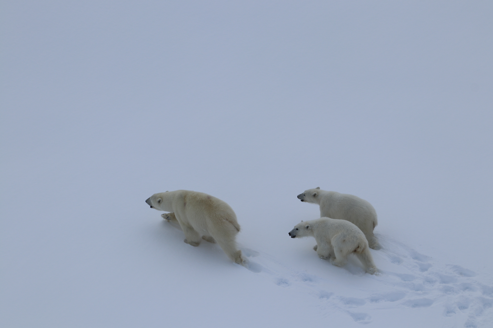

<<<<<<< HEAD
---
editor_options: 
  markdown: 
    wrap: 72
---

# Characterizing the Reproductive Microbiome of Female Polar Bears

{width="527"}

This repository contains the code and analysis files for my master\'s
thesis at the University of Washington School of Aquatic and Fishery
Sciences. This analysis includes work on the reproductive microbiome of
female polar bears (*Ursus maritimus*). I use 16S rRNA gene sequencing
to compare microbial communities in wild bears from Southeast Greenland
and zoo-housed bears across the United States.
=======
# Characterizing the Reproductive Microbiome of Female Polar Bears

This repository contains the code and analysis files for my master's thesis at the University of Washington School of Aquatic and Fishery Sciences. This analysis includes work on the reproductive microbiome of female polar bears (*Ursus maritimus*). I use 16S rRNA gene sequencing to compare microbial communities in wild bears from Southeast Greenland and zoo-housed bears across the United States.
>>>>>>> 79f04fd (updated README.md)

### Repository structure

| Col1 | Col2 |
|------|------|
|      |      |
|      |      |
|      |      |
|      |      |
|      |      |
|      |      |
